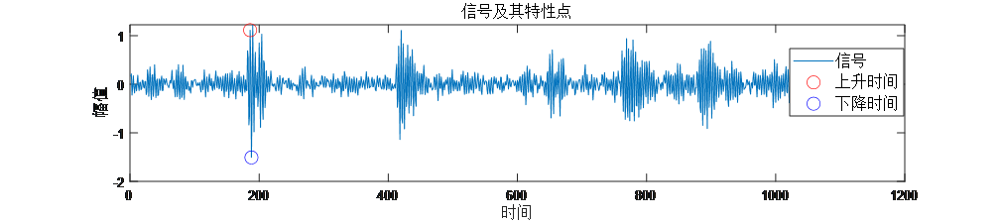
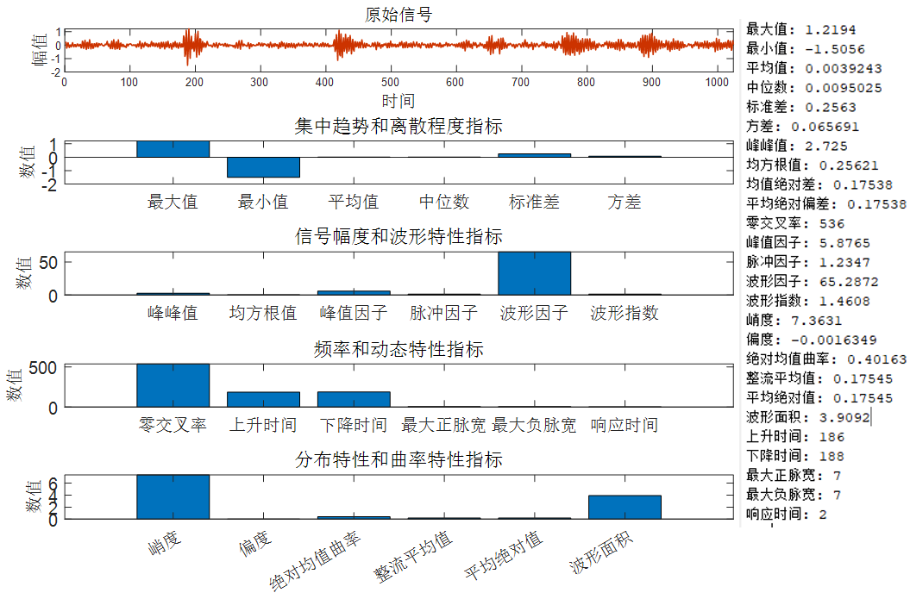

# Signal Analysis Tool! Signal Analysis Indicators, Feature Extraction, Signal Preprocessing, Frequency Analysis, Anomaly Detection, Energy Analysis, Dynamic Response, etc. MATLAB Program Code

Applicable Platform: MATLAB 2023 and above.
The following describes six aspects of signal characteristics:
1. Trend and Dispersion
2. Amplitude and Waveform Characteristics
3. Frequency and Dynamic Characteristics
4. Distribution Characteristics
5. Curvature Characteristics
6. Energy Accumulation Characteristics
1. Indicators for describing the central tendency and dispersion:
- Maximum Value (Max Value): The highest value in the data set, reflecting extreme cases of the data.
- Minimum Value (Min Value): The lowest value in the data set, reflecting another extreme case of the data.
- Mean Value (Mean Value): The arithmetic mean of the data, reflecting the overall level of the data.
- Median Value (Median Value): The value in the middle after sorting the data, reflecting the median level of the data, unaffected by extreme values.
- Standard Deviation (Standard Deviation): Reflecting the degree of dispersion of the data, indicating the average deviation of the data from the mean.
- Variance (Variance): The square of the standard deviation, reflecting the overall degree of dispersion of the data.
- Mean Absolute Deviation (MAD): The average of the absolute differences between each data point and the mean, reflecting the average deviation of the data from the mean.
- Mean Absolute Deviation (MAD): Similarly to MAD, representing the average absolute deviation of data points from the mean.
2. Indicators for describing the amplitude and waveform characteristics of signals:
- Peak-to-Peak Value (Peak-to-Peak Value): The difference between the maximum and minimum values of the signal, reflecting the amplitude range of the signal.
- RMS (Root Mean Square): The square root of the square of the signal's mean value, representing the effective value or average power of the signal.
- Peak Factor (Peak Factor): The ratio of the maximum value of the signal to its RMS value, reflecting the relative size of the signal peak.
Pulse factor (Crest Factor): The ratio of the peak value to the root mean square value of a signal, similar to the Peak Factor and often used for pulse signal analysis.
Waveform factor (Form Factor): The ratio of the root mean square value to the average absolute value of a signal, reflecting the complexity of the signal shape.
Shape factor (Shape Factor): A parameter representing the shape of a signal, usually related to the waveform factor.
3. Indicators describing the frequency and dynamic characteristics of signals
Zero crossing rate (Zero Crossing Rate): The number of times the signal passes through zero points per unit time, reflecting the frequency characteristics of the signal.
Rise time (Rise Time): The time required for the signal from low level to high level, reflecting the response speed of the signal.
Fall time (Fall Time): The time required for the signal from high level to low level, reflecting the descent speed of the signal.
Maximum positive pulse width (Maximum Positive Pulse Width): The maximum interval of time that the signal is in positive level, reflecting the pulse characteristics of the signal.
Maximum negative pulse width (Maximum Negative Pulse Width): The maximum interval of time that the signal is in negative level, reflecting the pulse characteristics of the signal.
Response time (Response Time): The response time of the system to the input signal, reflecting the dynamic performance of the system.
4. Indicators describing the distribution characteristics of signals
Kurtosis (Kurtosis): Reflects the sharpness of the signal distribution, with high kurtosis indicating a steeper peak.
Skewness (Skewness): Reflects the symmetry of the signal distribution, with positive skewness indicating a right-skewed distribution and negative skewness indicating a left-skewed distribution.
5. Indicators describing the curvature and absolute value characteristics of signals
Mean absolute curvature (Mean Absolute Curvature): The average absolute value of the signal curvature, reflecting the smoothness of the signal change.
Rectified Mean Value (RMV): The average of the absolute values of the signal, commonly used for the analysis of AC signals.
Mean Absolute Value (MAV): The average of the absolute values of the signal, representing the average strength of the signal.
⑥ Program Introduction: Indicator of the total energy or cumulative value of a signal.
Waveform Area (Area Under Curve): The area under the curve of the signal, reflecting the total energy or cumulative value of the signal.
Program Results:
Partial Program
1. Average Absolute Value

## Images

<!-- PAYMENT_BLOCK -->

## Get this dataset

- Payment link (Stripe): [Buy now](https://buy.stripe.com/3cs8yP7sY87d0vu9AB)
- Payment QR code: 

<!-- /PAYMENT_BLOCK -->
